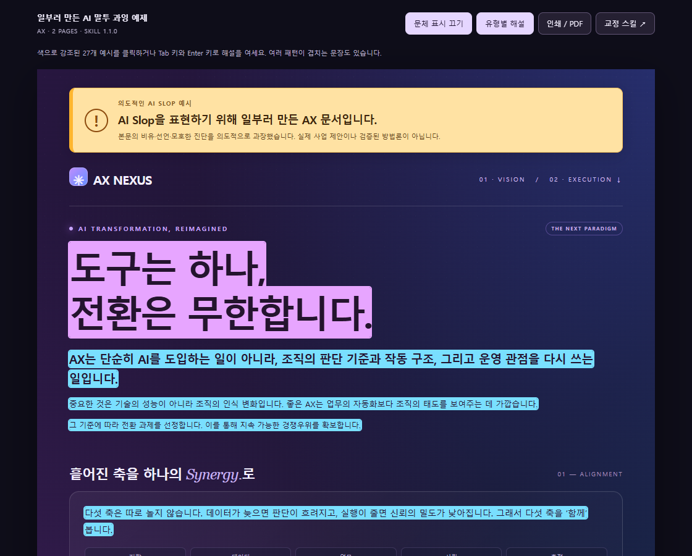

# heeseok-korean-anti-slop

연구·기술 문서와 강의·발표 자료에서 번역투, 과장된 비유, 설명이 빠진 원칙문을 찾아 고치는 한국어 편집 스킬입니다. **사실·수치·전문 용어·주장의 강도와 원문의 말투를 보존**합니다.

## 문체 예제 먼저 보기

**[AX 문체 과잉 예제 열기 ↗](https://ohheeseok.github.io/heeseok-korean-anti-slop/)** · [HTML 파일](ax-ai-slop.html)

[](https://ohheeseok.github.io/heeseok-korean-anti-slop/)

AI 말투를 일부러 과장해 쓴 2페이지 문서입니다. ‘문체 표시’를 켜면 27개 구간에 색상이 표시되고, 문장을 누르면 피하려는 패턴과 교정 시 주의할 점을 볼 수 있습니다. 본문의 사업 주장과 보장 표현은 교육용 예시입니다.

## 어떤 표현을 다루나요?

| 분류 | 예시 | 검토할 내용 |
|---|---|---|
| L1 번역투·정형 문형 | `~에 있어서`, `A의 B의 C`, `기준은 분명합니다`, `~이 병목입니다`의 반복 | 조사·명사구·정형 문장이 실제 설명을 대신하는지 확인합니다. |
| L2 은유·경구 | `6칸을 채운다`, `손잡이를 돌린다`, `사람은 하나지만 자리는 두 개입니다`, `여운의 농도` | 비유가 가리키는 대상과 행동을 찾아 직접 설명합니다. |
| L3 압축 선언·연어 | `성공을 전제하지 않는다`, `효과를 절제한다`, `조기 종료·재샘플링의 오판 비용` | 생략된 관계와 서술어의 뜻을 확인하고 문맥에서 풀어 씁니다. |

같은 표현도 문맥에 따라 자연스러울 수 있습니다. 실제 양식의 칸, 장치의 손잡이, 수학적 좌표계와 정의된 기술 용어는 유지합니다. ‘~한다’라는 어미나 세 항목의 나열만으로 교정 여부를 정하지 않습니다. AI 작성 여부를 판별하는 도구는 아닙니다.

## 교정 예시

아래는 문맥을 함께 제시한 편집 예시입니다. 표현을 기계적으로 바꾸는 치환표로 사용하지 않습니다.

| 원문 | 교정 예시 | 판단 |
|---|---|---|
| 이 모델에 의해 생성되어진 결과를 확인합니다. | 이 모델이 생성한 결과를 확인합니다. | 행위자가 명시되어 있어 피동을 줄일 수 있습니다. |
| 기업의 데이터의 안전한 관리의 효율성 | 기업 데이터를 안전하게 관리할 때의 효율 | 수식 관계를 유지하며 속격 연쇄를 풉니다. |
| 가정을 남긴다. | 가정을 명시한다. | 어색한 동사 결합을 고칩니다. |
| 비용을 센다. | 비용을 계산한다. | 비용값을 구한다는 문맥일 때의 예시입니다. 집계·포함 범위를 뜻하면 다르게 씁니다. |
| 조기 종료·재샘플링의 오판 비용을 기록한다. | 조기 종료·재샘플링과 관련된 오판으로 발생한 비용을 기록한다. | 사건 관계만 풀고 비용의 단위나 측정법은 추가하지 않습니다. |
| 기준은 분명합니다. 금요일 17시까지 제출한 안건만 심사합니다. | 금요일 17시까지 제출한 안건만 심사합니다. | 정보 없는 예고를 줄이고 시각과 ‘만’의 범위를 보존합니다. |
| 기획과 검수는 한 사람이 맡습니다. 사람은 하나지만 자리는 두 개입니다. | 기획과 검수는 한 사람이 맡습니다. | 같은 내용을 되풀이한 경구를 줄입니다. 앞 문맥이 없으면 ‘자리’를 역할로 단정하지 않습니다. |
| PDF 추출에 40초가 걸려 전체 처리 시간이 늘어납니다. PDF 추출이 병목입니다. | PDF 추출에 40초가 걸려 전체 처리 시간이 늘어납니다. | 이미 설명한 제약을 되풀이하는 진단만 줄입니다. 실제 병목 용어를 일괄 금지하지 않습니다. |

`효과를 절제한다`처럼 뜻이 갈리는 표현은 과대평가 금지·영향 제한 중 하나로 단정하지 않습니다. 확인되는 부분은 고치고, 뜻이 불명확한 구간만 원문을 유지해 확인 사항을 남깁니다.

## 설치

저장소 전체를 스킬 폴더에 복제하면 지침·참고 문서·검사기를 함께 사용할 수 있습니다. 아래 명령은 대상 폴더가 없을 때 실행합니다. 이미 설치했다면 [업데이트](#업데이트)를 참고하십시오.

### Codex

Windows PowerShell:

```powershell
New-Item -ItemType Directory -Force "$env:USERPROFILE\.agents\skills" | Out-Null
git clone https://github.com/ohheeseok/heeseok-korean-anti-slop.git "$env:USERPROFILE\.agents\skills\heeseok-korean-anti-slop"
```

macOS / Linux:

```bash
mkdir -p ~/.agents/skills
git clone https://github.com/ohheeseok/heeseok-korean-anti-slop.git ~/.agents/skills/heeseok-korean-anti-slop
```

프로젝트 전용 경로는 `.agents/skills/heeseok-korean-anti-slop/`입니다. [Codex 스킬 문서](https://learn.chatgpt.com/docs/build-skills)

### Claude Code

Windows PowerShell:

```powershell
New-Item -ItemType Directory -Force "$env:USERPROFILE\.claude\skills" | Out-Null
git clone https://github.com/ohheeseok/heeseok-korean-anti-slop.git "$env:USERPROFILE\.claude\skills\heeseok-korean-anti-slop"
```

macOS / Linux:

```bash
mkdir -p ~/.claude/skills
git clone https://github.com/ohheeseok/heeseok-korean-anti-slop.git ~/.claude/skills/heeseok-korean-anti-slop
```

프로젝트 전용 경로는 `.claude/skills/heeseok-korean-anti-slop/`입니다. [Claude Code 스킬 문서](https://code.claude.com/docs/en/skills)

### 업데이트

설치한 스킬 폴더에서 실행합니다.

```bash
git pull --ff-only
```

두 도구에 각각 설치했다면 각 폴더에서 업데이트합니다. 한 폴더를 junction이나 symlink로 공유한다면 실제 파일이 있는 폴더에서 실행합니다. 로컬 변경 때문에 업데이트가 중단되면 변경 내용을 먼저 확인하십시오.

## 사용

에이전트에 스킬 이름과 검토할 자료를 지정합니다.

```text
heeseok-korean-anti-slop 스킬로 report.html의 한국어 문구를 다듬어줘.
수치·인용·전문 용어·추측의 강도와 원문 말투는 유지해줘.
뜻이 불명확한 부분은 따로 알려줘.
```

자료를 읽고 스킬만 개선하려는 경우에는 원본을 수정하지 않도록 요청할 수 있습니다.

```text
이 발표자료의 AI 말투를 분석해서 스킬을 개선해줘. 발표자료 원본은 수정하지 마.
```

교정문과 주요 변경 이유를 제공하고, 확인이 필요한 사항은 본문 밖에 적습니다. 긴 자료는 `위치 | 원문 | 교정 | 규칙 ID`로 정리할 수 있습니다. 문체를 고치면서 디자인·수식·프로그램 동작을 바꾸지 않습니다.

## 검사기

Python 표준 라이브러리만 사용하며 파일을 읽어 검토 후보를 출력합니다. 자동 교정은 하지 않습니다. 저장소 루트에서 실행하는 예시입니다.

```bash
python scripts/scan_slop.py report.html
python scripts/scan_slop.py report.html --hidden
python scripts/scan_slop.py draft.md --rules L2,L3 --examples 5
python scripts/scan_slop.py style-guide.md --skip-quoted
```

`report.html` 등은 실제 파일 경로로 바꾸십시오. 다른 폴더에서 실행할 때는 스크립트 경로도 지정합니다.

| 옵션 | 동작 |
|---|---|
| `--hidden` | HTML 본문 외에 접근성 라벨·메타 텍스트·일부 JS 안내 문자열도 검사합니다. |
| `--rules` | 쉼표로 구분한 레이어 또는 구현된 규칙 ID를 선택합니다. `L3-1`은 `L3-1a`도 포함하며 `L1-1`은 `L1-12`를 포함하지 않습니다. |
| `--examples N` | 규칙별 예시를 최대 N개 표시합니다. 0은 건수만 출력합니다. |
| `--skip-quoted` | Markdown 코드 펜스·한 줄 인용·인라인 코드의 예시 문구를 제외합니다. |

문맥 전용 규칙은 코드로 구현되어 있지 않습니다. 미구현 ID·빈 선택 항목·음수 예시 수는 종료 코드 2로 알립니다. 정상 실행은 후보가 있어도 종료 코드 0이며, 종결어미 분포는 필터와 무관하게 출력됩니다.

검사 결과의 행 번호는 추출한 텍스트 기준입니다. HTML 소스 행 번호와 다를 수 있습니다. 정적 HTML 추출은 CSS 표시 상태·실행 후 DOM·전체 JavaScript 문법을 해석하지 않습니다. JS 문자열의 연결·유니코드 이스케이프, 여러 줄 인용의 경계도 완전히 처리하지 못합니다. 실제 손잡이 같은 표현이 후보로 나올 수 있으며, 후보가 0개여도 정확하거나 자연스러운 글이라는 뜻은 아닙니다.

회귀 검사는 `python -m unittest discover -s tests -v`로 실행합니다. 검사기의 동작을 확인하며 문장 교정의 의미 보존 전체를 자동 검증하지는 않습니다.

## 세부 지침과 검토 기록

- [SKILL.md](SKILL.md): 요청 범위, 의미 보존, 작업·보고 방식
- [발표자료](references/presentation-prose.md): 가짜 대조, 목적 없는 공동 검토, 감각적 추상어 등 8유형
- [강의·실습 자료](references/lecture-prose.md): 신체·공간 비유, 시연용 인용, 실제 절차와 완료 조건
- [논문·기술 해설](references/technical-explanation.md): 병목 진단, 캐릭터화, 근거와 보장 범위
- [문체 안내](references/style-patterns.md): 은유·경구형 슬롭, 은유·수사학 슬롭, 초압축 메니페스토 슬롭, 원칙주의적 의사 엄밀성
- [의미 보존 점검 사례](references/behavioral-checks.md), [전체 점검 기록](docs/full-review-1.1.0.md), [변경 기록](CHANGELOG.md)

im-not-ai, korean-humanizer 등 공개 지침에서 연구·기술 문서에 필요한 편집 원칙을 선별했습니다. 전체 분류 목록이나 다중 에이전트 실행·자동 복원 기능을 통합한 것은 아닙니다. [출처와 반영 범위](references/sources.md)를 확인할 수 있습니다.

Codex·Claude·Gemini를 사용해 작성하고 검토했습니다. 검토 의견은 원문 대조와 코드 실행 결과를 확인한 뒤 반영했습니다. 후보 수나 도구 간 동의 수를 품질 점수로 사용하지 않습니다. [이전 교차 검토 기록](docs/review-2026-10-24.md)
